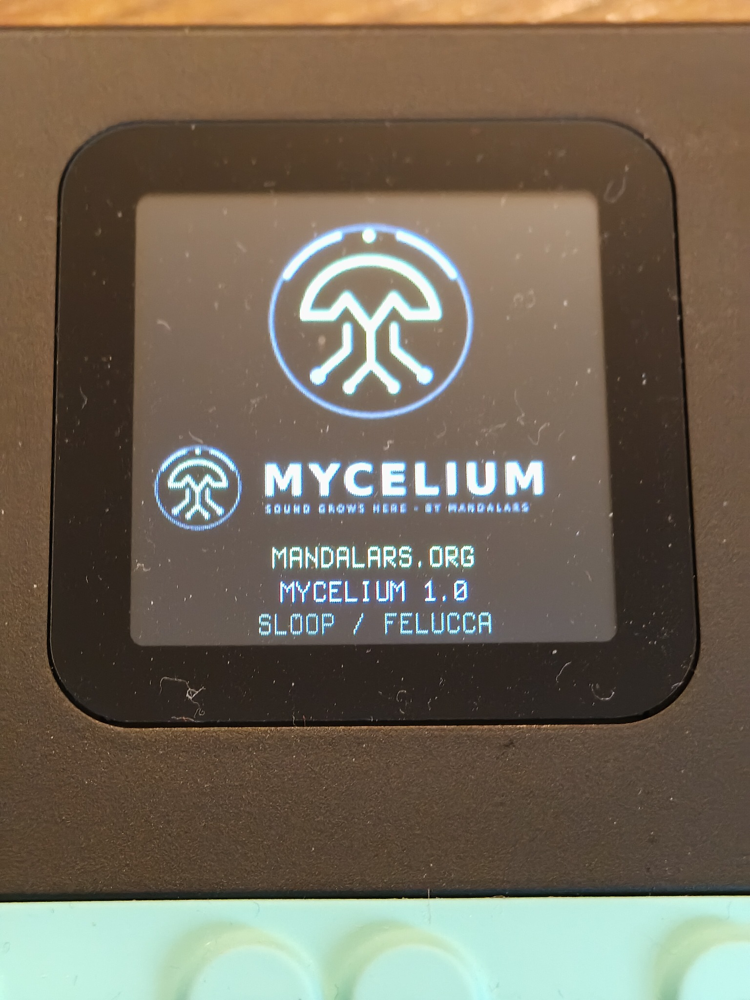

# MYCELIUM FM-1

MYCELIUM is a free, open-source alternative firmware for the M-VAVE FM-1, built on Felucca and SLOOP. It brings Forest, Psytrance, Goa and Hitech grooves, original drum assets and icons, and four factory songs to the hardware.

## Version 1.0 — test release

Download the installable `.fwsc` from this repository’s Releases. The package identity is `FM-1_900` and the package includes the Felucca update loader. Installation and reboot on the project device are documented; a complete physical listening and controls test remains outstanding. This is a test release. Back up your work before updating.

SHA-256: `9aa2802a0ac07f412e36c079c8034820b7405e3477468d0b3cfc7fd3f93e0da8`

## Corresponding source and building

The complete supplied source tree is in [Mycelium-FM1-1.0-Quellcode.zip](Mycelium-FM1-1.0-Quellcode.zip). Extract it and read `BUILDING.md` for the JieLi toolchain, AC79 SDK dependencies, build options and tests. Firmware, update-loader sources, asset generators, licensing and provenance are included. The package passed identity, loader-marker and internal CRC checks; a fresh reproducible build has not been performed here.

## Install, recovery and credits

Read the [installation instructions](https://www.mandalars.org/mandalars/fm1/anleitung.html) before flashing. Recovery may require [FM-1-transporter](https://github.com/kurogedelic/FM-1-transporter). Firmware updates are at your own risk.

Based on Felucca by Leo Kuroshita / Hügelton Instruments and SLOOP; upstream copyright notices and asset-specific licences remain in the source archive. Firmware code is GPL-3.0-only; see [LICENSE](LICENSE) and the archive’s `LICENSING.md`. Independent project; no official affiliation with M-VAVE.

[MYCELIUM home](https://www.mandalars.org/mandalars/) · [Firmware page](https://www.mandalars.org/mandalars/fm1/) · [FM-1 Hub](https://fm1.designburgapps.com/)

The browser studio uses a different sound engine from the hardware firmware.
